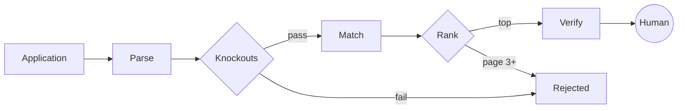
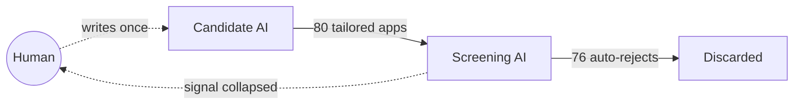

It's 9pm and somewhere an engineer is applying for jobs. Not writing applications — *running* them. Paste a job description into a script, a model rewrites the resume and cover letter to match the posting's exact language, hit submit, next. 80 roles before midnight. It feels productive. And the script is already the manual version: a wave of tools now skips the pasting entirely — they find matching jobs *and* submit on the candidate's behalf. The human has been promoted out of their own job search.

On the other side, most of those 80 companies run an applicant tracking system that parses the incoming resume, scores it against the same job description, and filters before a human ever logs in. A model wrote the application. A model read it. By morning most are gone, auto-screened in milliseconds, no person in the loop on either end.

2 machines, trained on roughly the same internet, talking past each other at scale. The person who can do the work and the team that needs them have both slipped out of the exchange. Attention is gone too. Throughput climbs on both sides and cancels itself out.

This isn't a thought experiment. [Greenhouse data reported by Business Insider](https://www.businessinsider.com/technology-broke-job-market-ats-recruiters-hiring-application-2025-11) puts the average job at 242 applications, nearly triple 2017, with an applications-to-recruiter ratio around 500:1 and 74% of candidates saying they use AI in the search. The stack absorbing that volume is not one model reading your soul; it's a pipeline, and pipelines discard work.

What follows is 14,572 engineering job postings: what the market asks for now, and what candidates can still control.

## The dataset

The dataset is **14,572 distinct software engineering roles** from **440 companies**, scraped from the public job boards most of tech actually hires through. It covers the boards the startups and scaleups use, plus the career systems behind the big established players (NVIDIA, Salesforce, Adobe, Intel) that most scrapes miss. That last group matters: without it the picture skews young.

Some ground rules, because a data post lives or dies on them:

- **Distinct roles, not raw listings.** Companies relist the same job once per city. Adobe had "Software Development Engineer" posted 27 times. Those collapse to 1. The raw pull was ~17,800 open positions; 14,572 is the deduplicated count of actually-distinct roles.
- **Software-adjacent only.** Software, infra, ML/AI, platform, firmware, plus robotics and autonomy. A drone company's "Autonomy Engineer" counts; its "Manufacturing Engineer" doesn't. Chipmakers needed a dedicated filter to strip silicon-design roles while keeping the real software jobs.
- **Boilerplate is stripped before counting.** Keyword shares are word-boundary matched and each role counts once. Critically, every company's repeated "About us" copy is removed first. Otherwise a tagline like Salesforce's "humans with agents" flags every single one of its postings as an AI job. A prefix-only stripper isn't enough: that paragraph often appears *after* variable ATS category text, so the cut has to find repeated chunks wherever they sit, not just at the top. Skipping this turns brand slogans into labor-market data.
- **"Agents" is counted conservatively.** A naive match for `agent` catches the Datadog Agent, Open Policy Agent, support agents, and clean-agent fire suppression. None of that is the claim. Here, agent language means `agentic`, `multi-agent`, or `agent(s)` sitting next to AI/model/tool/workflow context.

Those last 2 corrections *lower* the headline numbers. A loose first pass put AI-native roles at 42% and agent language at 25.5%. The conservative pass puts them at 38.8% and 22.7%.

This data does not show a trend. It is a snapshot of what's open right now: a cross-section, not a time series. "Shows up in 22.7% of roles" means 22.7% of roles today, not 22.7%-and-rising.

(Why no Hacker News "Who is Hiring?" data, the obvious source? Because those threads now run an aggressive AI/account filter, which makes them a biased, shrinking sample. Even the engineers' own watering hole has put a machine between you and the job post.)

## The numbers that don't fit the narrative

**Agent language has caught up to the cloud, and passed "LLM."**

Here is the conservative keyword leaderboard across all 14,572 roles:

| Keyword | Share of roles |
|:--|--:|
| Python | 39.6% |
| Machine learning (classic) | 25.6% |
| AWS | 22.9% |
| **agent language** | **22.7%** |
| Kubernetes | 18.9% |
| LLM | 17.0% |

Treat AWS and agent language as tied: agent language has reached the AWS/Kubernetes tier of job-posting vocabulary, while "LLM" appears in 17.0% of roles. Employers are asking less for "LLM experience" in isolation and more for the system around it: agents, tools, evals, reliability. The paid work moved from the model to the software wrapped around the model.

**AI is in ~39% of engineering roles, and the split tracks company age.**

Tag a role "AI-native" if its role-specific text (after the boilerplate strip) mentions any concrete AI marker: LLM, agents, RAG, embeddings, eval, fine-tuning, prompts, MLOps, or a model API. Overall, **38.8%** of all roles qualify. Split by company type:

| Company type | AI-native share |
|:--|--:|
| AI-native startups | 51.6% |
| Venture-backed scaleups | 38.2% |
| Big-tech (NVIDIA, Adobe…) | 35.2% |
| Legacy enterprise | 34.8% |

Startups betting the company on AI show it in half their roles. Older companies cluster in the mid-30s, with big-tech and legacy enterprise close enough to be indistinguishable. This is not "every engineering job is an AI job." It is AI as a baseline requirement, strongest at younger companies.

**The field is bimodal. You're an AI shop or you're not.**

Drill into individual companies and the middle empties out. A cluster sits at essentially **100%** AI-native, where every engineering role touches it: Cognition, LangChain, Cursor, Vercel, Decagon, Replit, Harvey. At the other end, deep-hardware, quantum, and defense firms are near zero even counting their genuine software roles: PsiQuantum 2.7%, Formlabs 2.9%, Veeva 3.6%, Shield AI 5.6%. Few companies live at 40-60%. Company by company, the distribution is polarized.

**The high-level AI words are common; the substrate words are not.** RAG appears in 4.5% of roles, MLOps 4.1%, fine-tuning 3.9%, eval 3.0%, embeddings 2.0%. Most companies are hiring people to *integrate* AI into a product or workflow. Far fewer are hiring for the machinery underneath: retrieval quality, eval harnesses, embedding systems, model operations. Most "AI roles" in this data aren't frontier-model roles. They're production-software roles with an AI dependency.

## 2 less flattering numbers

**The bottom rung of the ladder is gone.** Of the roles that state a seniority level in the title, senior-and-above outnumber junior, new-grad, and intern roles **30 to 1**. Only 1.5% of all roles are junior-coded. The industry is overwhelmingly hiring people who already know how to do the job, not people who want to learn it.

**Remote collapsed to about 1 in 4, and it's a class divide.** 22.9% of roles are remote overall, but the average is meaningless once you split by who's hiring:

| Company type | Remote roles |
|:--|--:|
| AI-native startups | 58.5% |
| Venture-backed scaleups | 19.0% |
| Legacy enterprise | 2.4% |
| Big-tech | 1.2% |

The "back to office" mandate you read about is almost entirely a large-company phenomenon. The newest, most AI-forward companies stayed remote; the giants dragged everyone back in.

## How the rejection machine actually works

The candidate-side arms race makes more sense once you look at the other side. An ATS is not "an AI reading your resume" in the way candidates picture. It's a pipeline, and each stage throws work away:

1. **Parse.** Your PDF gets shredded into fields: titles, dates, a flat bag of skill tokens. Fancy multi-column layouts degrade this; the parser wants boring structure. A beautiful resume can score *worse* because the parser choked on it.
2. **Knockouts.** Hard gates the recruiter set: work authorization, location, a required years-in-skill, a credential. These are boolean. No model softens them. Miss one and you're filtered before anything intelligent happens. This is most of those instant rejections.
3. **Match.** Now scoring. Older systems do keyword and phrase overlap against the JD. Newer ones embed your resume and the JD into vectors and score similarity, which sounds smarter but rewards the same thing: *describing your work in the words the posting used.* "Built retrieval-augmented generation pipelines" and "made a docs Q&A bot" can be the same project; only the first matches "RAG" and lands near the JD in vector space.
4. **Rank.** A recruiter sees a sorted list and reads the top of it. Page 3 does not exist.
5. **Verify.** The more AI-generated applications flood in, the more friction employers bolt on after the ranking: take-home assessments, live screens, AI-run interviews, identity checks, work samples, structured questions. The end of the funnel is getting harder because the front got easier to game.

Now watch what mass-generated applications do to this. Asked to "tailor my resume to this JD," the model produces fluent, plausible, generic-confident prose. It hits the obvious nouns. But so does everyone else's model, drawn from the same training distribution. The embedding-match step sees a wall of near-identical, near-average vectors and has little to separate them by. Worse, the fluff routinely invents adjacent-but-wrong specifics that sail past the parser and fail the instant a human asks 1 concrete question.

There is one measured shortcut. A [2025 paper on AI self-preferencing in hiring](https://arxiv.org/abs/2509.00462) found that LLM-based evaluators tend to prefer resumes written by the same model: candidates using the matching model were 23% to 60% more likely to be shortlisted than equally qualified applicants with human-written resumes. That's alarming, and it is not a strategy. You don't know which model (if any) is grading you, the advantage evaporates when everyone converges on the same optimized prose, and it does nothing for the human 5 minutes later. Self-preference is a bug in 1 screening step, not a durable edge.

So the candidate-side AI doesn't beat the system. It feeds the system the high-volume, low-information input the system is worst at telling apart, and best at discarding in bulk.

## The symmetry break

For most of hiring's history, both sides paid real cost. Writing a tailored application was slow; reading one was slow. That mutual cost *was* the signal. Effort was legible because effort was expensive. A real cover letter meant something because it took an hour you could've spent elsewhere.

LLMs collapsed the cost on both sides at the same time. Not "AI entered hiring," but that it entered *symmetrically*. When generating an application and screening one both round to free, the old signal (effort, fluency, polish, the mere existence of tailored words on the page) goes to zero on both ends at once. You can no longer infer much about a candidate from a well-written application, because a well-written application is now the default output of a 30-second prompt. The machines neutralize each other and the channel goes dark.

When a signal collapses, value moves to whatever is still costly to fake:

**Verifiable, specific, true correspondence between a real person and a real role.**

Fluency is free now. Keyword overlap gets stuffed. Application volume only worsens the pileup. What still matters is the precise overlap between what you have *actually done* and what this specific role *actually needs*, stated concretely enough to survive both the embedding match and a skeptical human 5 minutes later.

A model can rewrite what you give it. It cannot create real overlap between your project and the role. If the posting asks for eval pipelines and you built one, say which pipeline, which metric moved, and what broke before you fixed it. If you didn't build one, fluent wording only moves the lie to the interview.

The useful part: once fluent wording stops counting, the advantage moves back to evidence. Not effort theater. Evidence.

## What works now

The practical version:

- **Match the posting's real language, when it's true.** If the JD says "RAG" and you built retrieval over docs, write "RAG." Not to trick the parser, but because it's the accurate word and it's the one being scored. The skill is *translation*, not invention: naming your real experience in the vocabulary this role uses. Read 3 of a company's postings and you'll learn its dialect.
- **Quantify.** "Cut p99 latency 40%," "served 12M requests/day," "took eval pass-rate 71% → 89%." Specific figures give the match step and the human something to verify.
- **Target fewer roles, harder.** Pick the 10 roles you're genuinely close to and make each application unmistakably about *that* role. 10 specific applications beat 80 plausible ones because the 80 compete in exactly the bucket the machine is built to bulk-discard.
- **Never invent.** Every fabricated specific is a landmine at the first technical screen. Beyond the ethics, the honest, narrow, true resume is the one that survives contact with a real interviewer.

And 2 channels that matter more than they used to because they are hard to mass-produce and easy to check:

- **Attributable work.** A repo whose commits map to your claims, a live demo that does the thing the JD describes, a write-up or talk that uses the right words because you actually solved the problem. The resume asserts; these prove.
- **Specific referrals.** Not "my friend is looking" — "I worked with her on X, this role needs X, here's the evidence." A referral works because it injects the costly, human, role-specific signal the machines stripped out.

If you do nothing else: stop optimizing to *get past* the filter and start optimizing to *be legible to* it. The same evidence that helps the filter helps the human behind it.

## The tool

Most resume tools generate more prose. [resumeoptimizer.app](https://resumeoptimizer.app) takes the opposite path: it lines real experience up against a specific posting's language and surfaces the genuine overlap. It will not invent experience that isn't there, because invented experience is what the filter and the interviewer are getting better at punishing.

---

*Data: 14,572 distinct software-adjacent technical roles from 440 companies' public job boards, pulled June 11, 2026. Cross-section, not trend. Keyword shares are "now," not "rising." Repeated company boilerplate is stripped before keyword counting, including chunks that appear after variable ATS text; agent language is counted only in AI/model/tool/workflow context; chip-hardware roles are filtered out of the chipmakers while their software, firmware, ML, and robotics roles are kept; same-role multi-location listings are deduplicated. Selection bias is real: these are companies that hire through public boards: tech, AI labs, devtools, fintech, defense-tech, chipmakers, and enterprises with public boards. The FAANG core (Apple, Meta, Amazon, Google, Microsoft) use internal systems with no public board and are absent, so if anything this undercounts the most established end of the market.*

*External corroboration: [Greenhouse via Business Insider](https://www.businessinsider.com/technology-broke-job-market-ats-recruiters-hiring-application-2025-11) on application volume and AI usage; [Xu, Li & Jiang (2025)](https://arxiv.org/abs/2509.00462) on AI self-preferencing in algorithmic hiring.*
